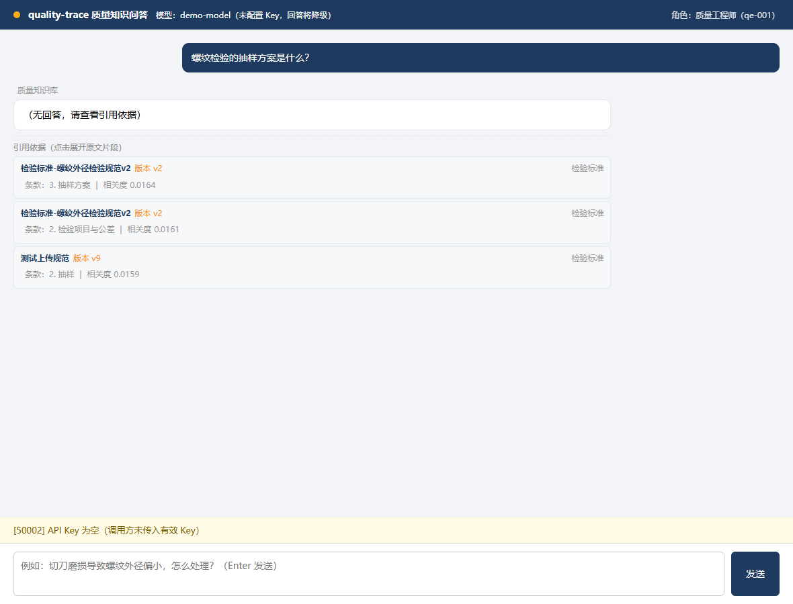
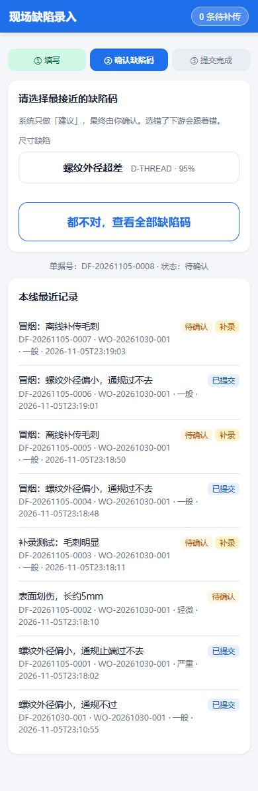
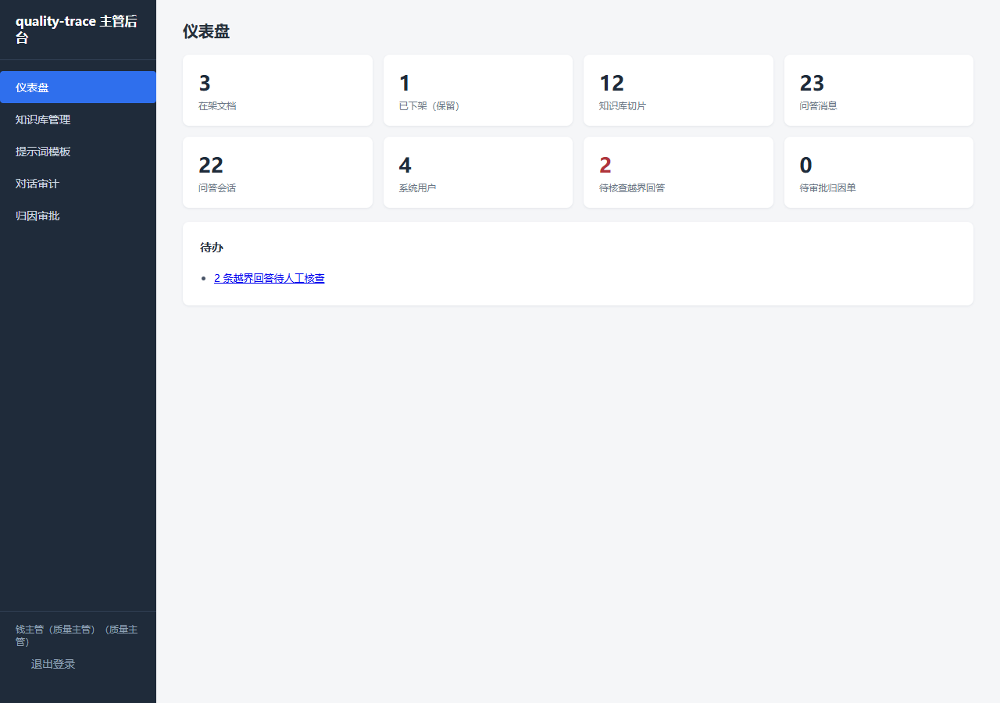

# quality-trace

> 制造业质量追溯与缺陷归因工具 —— 把「这批货为什么不良」变成一条可核对、可复现、可审计的证据链。

一个不良品单进去，四样东西出来：**关联对象、疑似原因排序、影响范围清单、8D 草稿**。

[]()
[]()
[]()

---

## 目录

1. [它要解决什么](#1-它要解决什么)
2. [Quick Start：五分钟跑起来](#2-quick-start五分钟跑起来)
3. [三个角色，三个入口](#3-三个角色三个入口)
4. [功能地图](#4-功能地图)
5. [架构总览](#5-架构总览)
6. [知识库与检索：两个必须正面回答的陷阱](#6-知识库与检索两个必须正面回答的陷阱)
7. [数据模型](#7-数据模型)
8. [接口一览](#8-接口一览)
9. [测试、冒烟与页面巡检](#9-测试冒烟与页面巡检)
10. [工程约定与目录结构](#10-工程约定与目录结构)
11. [常见问题](#11-常见问题)
12. [边界与后续路线](#12-边界与后续路线)

---

## 1. 它要解决什么

制造现场的两个问题通常被分开处理，结果两边都不彻底：

1. **追溯**：这批成品的原料是哪一批、经过哪台设备、哪班人、哪次检验——散落在 ERP、MES、纸质单据里；
2. **归因**：不良品单上写着「尺寸超差」，但到底是人、机、料、法、环、测哪一环出的问题，靠老师傅经验。

本项目把两者接起来：**先有谱系，才谈归因；归因结论必须能落回具体批次、工序和时间窗口。**

它不追求「AI 自动定责」。系统只做到 L3——**因果假设，且必须标注「待验证」**；
L4 的根因确认需要人签字，这是产品红线，不是技术限制。

### 三条不可让步的设计原则

| 原则 | 落地方式 |
|---|---|
| **文档 ≠ 事实** | 检索到的条文只能作为「参考依据」，事实性陈述必须来自结构化数据行 |
| **标准有版本** | 每份标准带版本号与生效区间；按业务时刻检索，废止版本物理上进不了候选集 |
| **判定权在人** | 缺陷提交只到 `pending`，8D 只出草稿，根因只能写「疑似（待验证）」 |

---

## 2. Quick Start：五分钟跑起来

### 2.1 环境

- Python 3.9+（开发环境为 3.13，CI 覆盖 3.9 / 3.11 / 3.13）
- 无需数据库服务：SQLite 单文件，开箱即用
- 无需 GPU / 向量库服务：默认 BM25 单通道，装 `faiss-cpu` 可开启向量通道

```bash
git clone https://github.com/linxionghao/-.git quality-trace
cd quality-trace

python -m venv .venv
.venv\Scripts\activate          # Windows
# source .venv/bin/activate      # Linux / macOS

pip install -r requirements.txt
pip install -e .
```

### 2.2 初始化演示数据

```bash
# 三角色账号 + 工单 + 缺陷码字典 + 知识库语料 + 审计样本与归因单
python scripts/seed_demo_data.py --kb --audit
```

脚本是**幂等**的：重复执行只更新描述字段，不会产生重复账号、重复文档或重复会话。

演示账号（密码与登录名相同，仅用于课程演示，生产环境严禁如此）：

| 账号 | 角色 | 数据范围 |
|---|---|---|
| `qe001` | 质量工程师 | 本人会话；全部缺陷单只读 |
| `leader01` | 班组长（line-01） | 本产线缺陷单，看不到归因与判定字段 |
| `manager01` | 质量主管 | 全部（知识库、提示词、审计、审批） |

### 2.3 启动

```bash
# Linux / macOS
bash scripts/run_server.sh

# Windows PowerShell
powershell -ExecutionPolicy Bypass -File scripts/run_server.ps1
```

脚本会先重建一次知识库索引，再在 `http://127.0.0.1:8000` 启动服务。

### 2.4 接入真实大模型（可选）

不配 Key 也能完整演示：检索、引用、降级提示全部可用，只是不生成自然语言回答。

```bash
# config/llm.yaml 里改成你的供应商地址与模型名
export QT_LLM_API_KEY=sk-xxxx        # Windows: set QT_LLM_API_KEY=sk-xxxx
```

供应商需兼容 OpenAI 协议（`/chat/completions`），换供应商只改 YAML 的 `base_url` 与 `model`。

---

## 3. 三个角色，三个入口

| 角色 | 入口 | 交互形态 | 能做什么 | 不能做什么 |
|---|---|---|---|---|
| 质量工程师 QE | `/` | 单页对话 + SSE 流式 | 按业务时刻提问、看引用原文、追溯历史会话 | 维护知识库、审批归因 |
| 班组长 SL | `/m` | 移动优先单页，三步流 | 现场录缺陷、拍照、确认缺陷码、离线补传 | 看归因结论、看标准判定、改他线数据 |
| 质量主管 QM | `/admin` | 服务端渲染后台 | 知识库上下架、改提示词、审计对话、审批归因、导出 8D | 代替工程师判定缺陷 |

### 三个入口的实际样子

**质量工程师问答页**——回答下方展示引用卡片，含文档名、版本号、条款号与相关度；
未配大模型时给出黄色降级提示，但引用照常返回：



**班组长现场录入端**——大按钮、少输入，第 2 步必须亲手点选缺陷码：



**质量主管后台**——仪表盘直出在架文档、切片、消息与待办统计：



---

## 4. 功能地图

### 4.1 知识库

| 能力 | 实现要点 |
|---|---|
| 上传 md / pdf | 版本号与生效区间**必填**；pypdf 抽取纯文本；同名同版本返回 40903 |
| 自动切片 | 先按标题分段，再按 500 字切片（80 字重叠）；切片记录条款号 |
| 向量化入库 | 可选；未配置 embedding 时标记 `vector_status=pending` 并返回 50004（非失败） |
| 列表与下架 | 下架是 `status=archived`，**不物理删除**；下架后切片即时退出检索索引 |
| 切片核对 | 管理页可展开任一文档的切片，确认切分质量 |

### 4.2 提示词模板

- 存数据库，**不写死在代码里**；`/chat` 每次请求实时读取当前 active 模板，改完下一条回答立即生效；
- 每次修改记录**修改人与时间**，历史只增不删，页面显示「最后修改：钱主管 · 2026-11-05 22:41」。

### 4.3 对话审计

三条规则在回答落库后自动执行，也可由主管手动补扫（规则升级后可重跑）：

| 规则 | 判定 | 典型样本 |
|---|---|---|
| `flag_root_cause` | 正文命中「根因已确定 / 根因就是 / 根本原因已查明」等 5 组正则 | 「经分析，根因已确定为切刀磨损」 |
| `flag_no_citation` | 状态 `complete`、正文非空、但引用数为 0 | 「这个批次建议直接判不合格」 |
| `flag_stale_version` | 任一引用指向已下架文档的（文档名 + 版本） | 引用了 v0-已废止 的抽样条款 |

- 支持按**角色 / 批次号 / 时间区间 / 仅看越界**四维筛选；
- 主管可标记「已核查」并写备注；**补扫不会覆盖人工核查结论**。

### 4.4 归因审批与 8D 导出

- 状态机：`submitted → approved / rejected`；重复审批返回 40906；
- 退回**必须填意见**（40001），否则工程师无从修改；
- 8D 导出：库里有草稿直接下载；没有则调 LLM 生成并缓存；LLM 不可用返回 50002，**绝不输出半截文件**；
- 草稿正文恒含红线提示「本报告为系统草稿，需人工复核后方可进入正式 8D 流程」。

### 4.5 班组长现场录入

| 能力 | 实现要点 |
|---|---|
| 双时间戳 | `occurred_at` 客户端发生时刻 / `recorded_at` 服务端落库时刻，分列存储 |
| 补录标记 | 两者相差 > 60 秒，或客户端显式声明 → `is_backfill=1`，前端显示黄色徽章 |
| 描述归一化 | LLM 输出候选码（限字典内、最多 3 个）；不可用则关键词 + 名称二元组回退 |
| 人工确认硬闸 | 建单只到 `draft`；必须 `POST /defects/{no}/confirm` 点选后才转 `pending` |
| 照片 | 浏览器 canvas 压缩（最长边 1280 / JPEG 0.7）；服务端按魔数校验、2MB 上限、按缺陷号落盘 |
| 弱网/断网 | localStorage 队列（上限 20），30 秒轮询 + 上线事件补传，`client_draft_id` 幂等去重 |
| 数据范围 | 班组长列表/详情的 SQL 强制 `line_id = 令牌产线`；他线单据一律 40404 |

---

## 5. 架构总览

### 5.1 五层与调用方向

```
┌──────────────────────────────────────────────────────────────────────┐
│ 入口层  api/                                                          │
│   FastAPI 路由 · JWT/Cookie 鉴权 · 参数校验 · 统一 {code,message,data} │
│   页面：/ 问答   /m 移动录入   /admin 主管后台（Jinja2）               │
└───────────────┬──────────────────────────────────────────────────────┘
                │ 只允许调用服务层；不得直接碰检索/LLM
┌───────────────▼──────────────────────────────────────────────────────┐
│ 服务层  core/services/                                                │
│   chat（问答编排）· auth（JWT）· knowledge_admin（上传/重建）          │
│   audit（越界检测）· attribution（审批/8D）· defects（录入两步流）     │
│   normalize（归一化）· photo（图片校验落盘）                           │
│   职责：用例编排、事务边界、权限的数据级过滤、降级决策                 │
└───────────────┬──────────────────────────────────────────────────────┘
                │ 组织调用；服务层之间不互相 import 业务实现
┌───────────────▼──────────────────────────────────────────────────────┐
│ 领域层  core/knowledge/ · core/llm/ · core/repo/                      │
│   检索（BM25 + 向量 + RRF）· 切片 · 提示词 · LLM 客户端 · SQLite 读写  │
│   纯函数优先；不 print、不读环境变量、不 import argparse               │
└───────────────┬──────────────────────────────────────────────────────┘
                │
┌───────────────▼──────────────────────────────────────────────────────┐
│ 数据层  data/trace.db（SQLite，WAL）                                   │
│   会话/消息/引用 · 知识库文档/切片/模板 · 工单/缺陷 · 归因单 · 用户    │
└──────────────────────────────────────────────────────────────────────┘
```

### 5.2 六条跨层硬规则

1. **检索层与 LLM 层互不调用**，只在服务层汇合——这样检索可单测、LLM 可替换；
2. **索引文件是派生物**：上传/下架后从数据库重建，检索永不以文件为权威；
3. **权限过滤在 SQL 层**：班组长令牌里的 `line_id` 直接拼进 WHERE，不靠前端隐藏；
4. **降级不等于失败**：50001/50002/50401 仍返回可用结果，只是标注 `degraded`；
5. **错误码前三位即 HTTP 状态**：40001→400、40406→404、40905→409；
6. **审计全链路可重放**：每次检索写 `retrieval_log`，引用结构化落库，消息保存 `prompt_hash`。

### 5.3 代码地图

| 路径 | 职责 | 约计行数 |
|---|---|---|
| `core/knowledge/ingest.py` | front-matter、切片、索引落盘 | 300+ |
| `core/knowledge/retrieval.py` | 分词、BM25、FAISS/numpy、RRF | 400+ |
| `core/knowledge/prompts.py` | 系统提示词、消息装配 | 150+ |
| `core/llm/client.py` | call_llm / stream_chat / embed_texts | 300+ |
| `core/repo/db.py` | 12 张表 + 60 余个读写函数 | 1000+ |
| `core/services/*.py` | 7 个服务模块 | 1200+ |
| `api/*` | 路由、依赖、SSE 桥接 | 900+ |
| `web/*` | 聊天页、移动端、6 个 Jinja2 模板 | 1500+ |
| `tests/*` | 12 个测试文件 | 1800+ |

---

## 6. 知识库与检索：两个必须正面回答的陷阱

### 6.1 陷阱一：v1 / v2 / v3 三版标准同时入库，只按相似度召回

**问题**：如果检索只按向量相似度排序，废止版往往措辞更「标准」、与问题更相似，
于是被当成现行要求写进答案——这在质量场景是事故，不是瑕疵。

**做法：三道闸，全部在代码里，不靠提示词。**

| 闸 | 位置 | 机制 |
|---|---|---|
| 第一道：入库即退出 | `kb_doc.status` | 下架 = `archived`，重建索引时整篇切片不写入 `chunks.json`；**物理上不在候选集** |
| 第二道：按业务时刻 SQL 过滤 | `repo.list_chunks_as_of()` | `status='active' AND effective_from <= as_of <= effective_to`，在数据库里筛完再检索 |
| 第三道：引用落库前复核 | `audit.detect_flags()` | 若引用指向已下架（文档名+版本），标记 `flag_stale_version`，主管审计可见 |

第二道闸是核心。`POST /api/v1/chat` 接受 `as_of`：

```json
{"question": "当时的抽样方案是什么？", "as_of": "2026-06-01"}
```

服务层此时**不读索引文件**，直接从数据库按该时刻取有效切片再建 BM25。
索引文件无法表达版本语义，这是它作为派生物必须让位的地方。

同时写入检索元信息，前端与审计都能看到：

```json
{"mode": "bm25_as_of", "version_gate": "sql", "as_of": "2026-06-01", "hits": 1}
```

**可复现的验证**（`tests/test_version_gate.py`，9 个用例）：

```bash
python -m pytest tests/test_version_gate.py -v
```

其中最关键的一条：用 v1 的原话提问，v1 也一条都检不到——

```python
hits, _ = svc.retrieve("每批抽 8 件 全检通止规", as_of="2026-06-01")
assert "v1" not in {h["chunk"]["doc_meta"]["version"] for h in hits}
```

另有两道配套约束：

- **as_of 格式错误直接 40001**，绝不静默按「当前」检索——追溯结论会因此失真；
- 该时刻没有任何有效文档时返回空结果（`hits=0`）而不是报错，前端提示「无依据」。

### 6.2 陷阱二：LLM 把检索到的文档当成事实结论

**问题**：模型会把「参考条文」写成「事实」，把「疑似原因」写成「根因已确定」，
还会编造不存在的条款号——文档一旦被当成事实，追溯链就断了。

**做法：三色证据模型 + 服务端引用校验，不信任模型自述。**

| 证据色 | 来源 | 输出约束 |
|---|---|---|
| **事实**（结构化） | 数据库行：工单、缺陷单、检验记录、设备日志 | 可直接陈述，必须带主键 |
| **参考**（文档） | 检索切片：文档名 + 版本 + 条款号 | 只能写「依据《…》v2 第 3 条」，并带 `[Cn]` 编号 |
| **假设**（推理） | 模型的因果推断 | 必须写「疑似 / 待验证」，禁止定论 |

落地的四个约束：

1. **提示词约束是软约束**：系统提示明确「材料是参考不是结论」「禁止说根因已确定」，
   但这不是保证——所以下面三条都在服务端做；
2. **引用必须可回查**：引用以结构化行落库（`chat_message_citation`），
   含 `source_file / version / clause / snippet / score`，审计页可逐条核对；
3. **越界自动标记**：回答落库后同步跑三规则（根因结论 / 无引用 / 废止版本），
   命中即标「疑似越界」，由主管人工核查——机器只提示，不定性；
4. **8D 的 D4 只能写「疑似根因（待验证）」**，草稿恒带「需人工复核」红线头。

> 为什么不做「自动拦截」：质量场景里误拦一条合规回答，代价高于让主管多看一眼。
> 所以系统选择「标记 + 可追溯」，而不是「静默改写」。

### 6.3 降级矩阵：每个依赖都有 Plan B

| 依赖 | 不可用时的行为 | 用户看到什么 | 错误码 |
|---|---|---|---|
| 大模型 | 只返回检索依据，不生成正文 | 黄色提示「大模型不可用，仅返回检索依据」+ 引用卡片 | 50002（非失败） |
| Embedding | 退化为 BM25 单通道 | 检索结果照常，元信息 `mode=bm25_only` | 50001（非失败） |
| 向量索引损坏 | 抛错而非静默空结果 | 红色提示「检索索引加载失败，请联系管理员」 | 50301 |
| 知识库为空 | 空命中，不编造 | 「未检索到相关依据」 | — |
| 照片上传失败 | 建单继续，照片可后补 | 提示「照片暂存失败，提交时将随单一起上传」 | 40003 |
| 断网 | 入本地队列，恢复后自动补传 | 顶栏角标「N 条待补传」+ 补录徽章 | — |
| LLM 归一化失败 | 关键词 + 名称二元组回退 | 仍给候选码，标注来源 keyword | — |

**降级语义的统一口径**：配置主动关闭不算降级；只有「配了但调用失败」才标 `degraded=true`。
这条口径有测试固定，避免演示环境永远亮黄条。

---

## 7. 数据模型

### 7.1 十二张表

| 域 | 表 | 关键字段与约束 |
|---|---|---|
| 身份 | `sys_user` | `role`（三角色）、`line_id`（班组长绑产线）、username 唯一 |
| 知识库 | `kb_doc` | 版本号 + 生效区间必填；`status` active/archived；同名同版本唯一索引 |
|  | `kb_chunk` | 条款号、切片正文、字符数；外键指向 kb_doc |
|  | `prompt_template` | 当前 active 模板正文；`updated_by / updated_at` |
|  | `prompt_template_history` | 每次修改的全文快照，只增不删 |
| 会话 | `chat_session` | 归属人、角色、`batch_no`（审计按批次筛）、状态 |
|  | `chat_message` | 双时间 + `status`(partial/complete) + 三列越界标记 + 三列核查 |
|  | `chat_message_citation` | 文档名/版本/条款/片段/分数，结构化可审计 |
| 生产 | `work_order` | 工单号、产品、`line_id`（数据权限锚点） |
|  | `defect_item` | 双时间、`is_backfill`、`client_draft_id` 唯一（离线幂等）、状态 draft/pending |
|  | `defect_code` | 缺陷码字典：分组、`keywords_json`（回退匹配） |
| 归因 | `attribution_order` | 证据链 JSON、L3 假设、审批状态机、8D 草稿缓存 |

### 7.2 双时间列：为什么每张业务表都有两个时间

```sql
occurred_at  TEXT NOT NULL   -- 业务时刻：现场真正发生的时间（客户端传）
recorded_at  TEXT NOT NULL   -- 录入时刻：数据落到系统的时间（服务端生成）
```

- 追溯要按**业务时刻**回答「当时的标准是哪一版」，而不是「录入时哪一版」；
- 补录判定靠两者差值：> 60 秒即打 `is_backfill`，报表里单列统计，避免污染实时率；
- 会话/消息/文档/缺陷/归因全部遵循同一约定，跨表时间口径一致。

### 7.3 SQLite 升级策略

- 建表全部 `CREATE TABLE IF NOT EXISTS`，可重复执行；
- 新增列用逐条 `ALTER TABLE` 尝试（SQLite 无 `ADD COLUMN IF NOT EXISTS`），失败即视为已存在；
- 已有数据库（阶段 2 建的 chat_message）可直接升级到批次 1c 的审计列，无需重建。

---

## 8. 接口一览

所有 JSON 接口统一返回：

```json
{"code": 0, "message": "成功", "data": {...}}
```

`code != 0` 时 `message` 恒为可直接展示的中文；HTTP 状态码取错误码前三位。
降级类（50001/50002/50401）HTTP 仍为 200，`degraded` 放在 `data` 里。

### 8.1 认证

| 方法 | 路径 | 角色 | 说明 |
|---|---|---|---|
| POST | `/api/v1/auth/login` | 全部 | 用户名密码 → JWT（12 小时） |
| GET | `/api/v1/auth/me` | 全部 | 校验令牌并返回当前用户 |
| POST | `/admin/login` | QM | 后台表单登录（HttpOnly Cookie） |
| POST | `/admin/logout` | QM | 退出 |

### 8.2 问答（QE）

| 方法 | 路径 | 说明 |
|---|---|---|
| POST | `/api/v1/chat` | SSE 流式问答；body 支持 `session_id`、`question`、`as_of` |
| POST | `/api/v1/sessions` | 新建会话 |
| GET | `/api/v1/sessions/{id}/messages` | 历史消息 + 引用（仅本人） |
| DELETE | `/api/v1/sessions/{id}` | 归档会话 |
| GET | `/api/v1/health` | 健康检查（索引状态） |

SSE 事件序列：`status`（正在检索依据…）→ `sources`（引用数组）→ `delta`（增量文本，多条）→ `done`。
断流或超时会先发 `sources` 再发 `error`，保证引用不丢。

### 8.3 主管后台（QM）

| 方法 | 路径 | 说明 |
|---|---|---|
| POST | `/api/v1/admin/documents` | 上传 md/pdf（multipart，版本与生效区间必填） |
| GET | `/api/v1/admin/documents` | 文档列表（状态/类型筛选） |
| GET | `/api/v1/admin/documents/{id}/chunks` | 切片核对 |
| POST | `/api/v1/admin/documents/{id}/archive` | 下架（不物理删除） |
| POST | `/api/v1/admin/documents/{id}/restore` | 恢复上架 |
| GET / POST / PUT | `/api/v1/admin/prompt-templates` | 读取 / 首次创建 / 修改（立即生效） |
| GET | `/api/v1/admin/audit/messages` | 审计列表（role/batch_no/date_from/date_to/only_flagged） |
| GET | `/api/v1/admin/audit/messages/{id}` | 审计详情（含引用） |
| POST | `/api/v1/admin/audit/messages/{id}/review` | 标记已核查 + 备注 |
| POST | `/api/v1/admin/audit/rescan` | 全量补扫越界标记 |
| GET | `/api/v1/admin/attributions` | 归因单列表 |
| GET | `/api/v1/admin/attributions/{id}` | 证据链 + 审批记录 |
| POST | `/api/v1/admin/attributions/{id}/approve` | 批准 |
| POST | `/api/v1/admin/attributions/{id}/reject` | 退回（必填意见） |
| GET | `/api/v1/admin/attributions/{id}/export-8d` | 下载 8D 草稿（Markdown） |

### 8.4 现场录入（SL）

| 方法 | 路径 | 说明 |
|---|---|---|
| GET | `/api/v1/defect-codes` | 缺陷码字典（按分组） |
| POST | `/api/v1/defects` | 建 draft + 返回候选码 |
| POST | `/api/v1/defects/{no}/confirm` | 人工确认缺陷码 → pending |
| GET | `/api/v1/defects` | 本线列表（字段按角色裁剪） |
| GET | `/api/v1/defects/{no}` | 详情（他线 40404） |
| GET | `/api/v1/work-orders/{id}` | 工单失焦校验 |
| POST | `/api/v1/uploads/photo` | 照片预上传，返回 token |

完整规范见 [`docs/api.md`](docs/api.md)；问答接口细节见 [`docs/chat-api.md`](docs/chat-api.md)。

---
