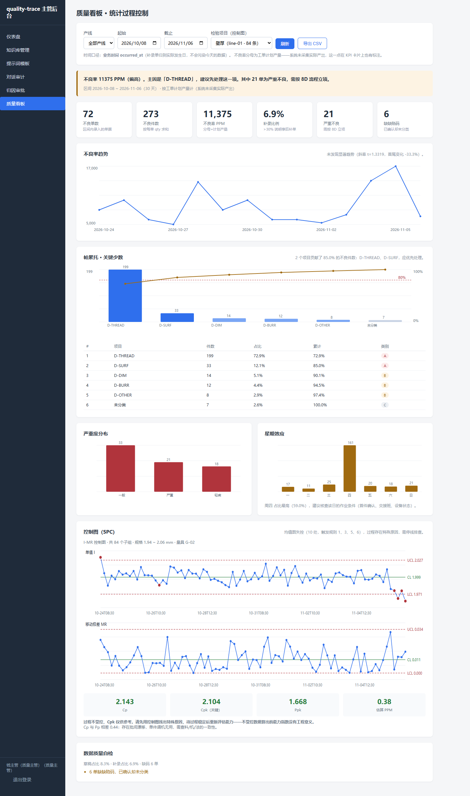
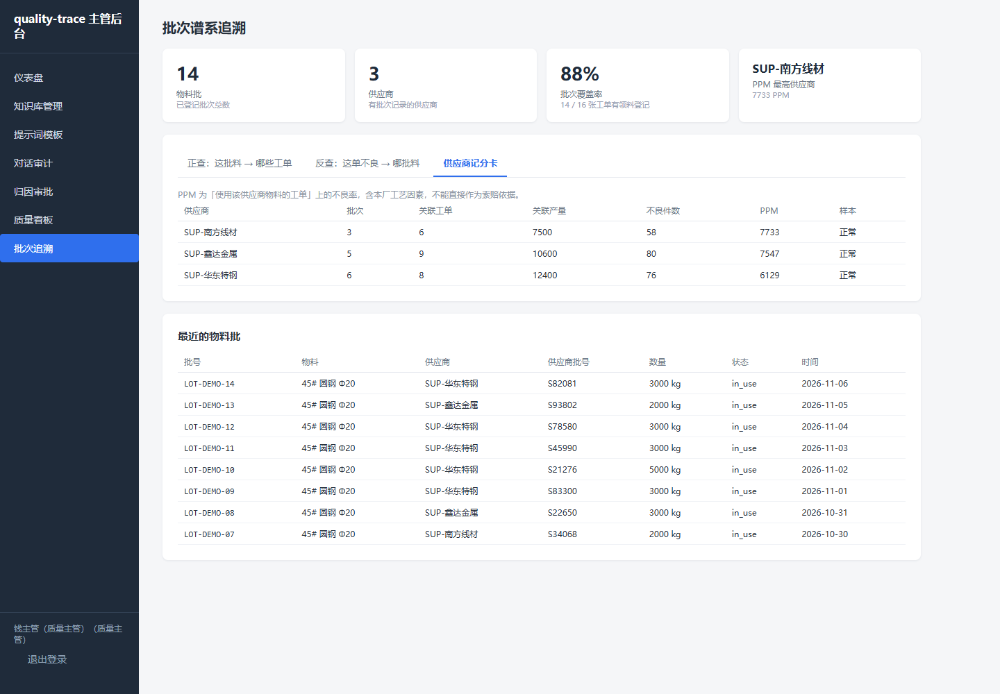
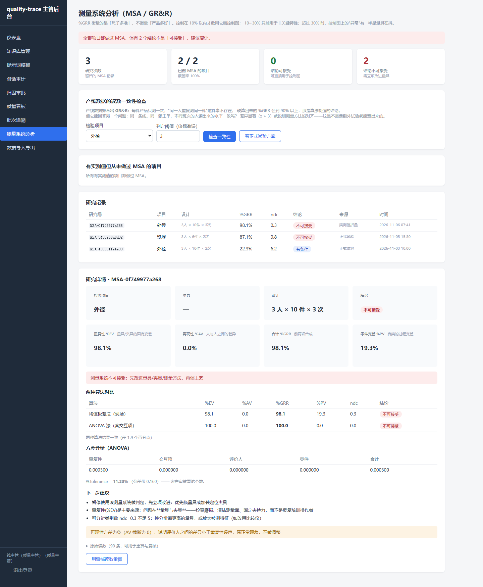
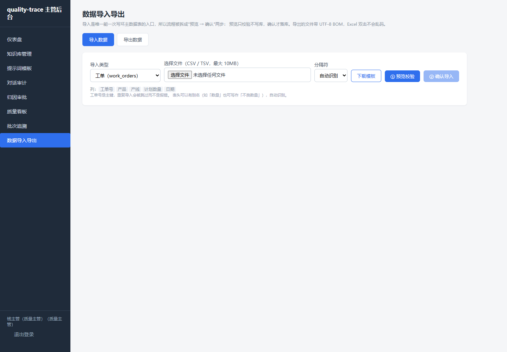

# quality-trace

> 制造业质量追溯与缺陷归因工具 —— 把「这批货为什么不良」变成一条可核对、可复现、可审计的证据链。

一个不良品单进去，四样东西出来：**关联对象、疑似原因排序、影响范围清单、8D 草稿**。

[]()
[]()
[]()
[]()

---

## 目录

1. [它要解决什么](#1-它要解决什么)
2. [Quick Start：五分钟跑起来](#2-quick-start五分钟跑起来)
3. [三个角色，三个入口](#3-三个角色三个入口)
4. [功能地图](#4-功能地图)
5. [架构总览](#5-架构总览)
6. [知识库与检索：两个必须正面回答的陷阱](#6-知识库与检索两个必须正面回答的陷阱)
7. [数据模型](#7-数据模型)
8. [接口一览](#8-接口一览)
9. [测试、冒烟与页面巡检](#9-测试冒烟与页面巡检)
10. [工程约定与目录结构](#10-工程约定与目录结构)
11. [常见问题](#11-常见问题)
12. [边界与后续路线](#12-边界与后续路线)

---

## 1. 它要解决什么

制造现场的两个问题通常被分开处理，结果两边都不彻底：

1. **追溯**：这批成品的原料是哪一批、经过哪台设备、哪班人、哪次检验——散落在 ERP、MES、纸质单据里；
2. **归因**：不良品单上写着「尺寸超差」，但到底是人、机、料、法、环、测哪一环出的问题，靠老师傅经验。

本项目把两者接起来：**先有谱系，才谈归因；归因结论必须能落回具体批次、工序和时间窗口。**

它不追求「AI 自动定责」。系统只做到 L3——**因果假设，且必须标注「待验证」**；
L4 的根因确认需要人签字，这是产品红线，不是技术限制。

### 三条不可让步的设计原则

| 原则 | 落地方式 |
|---|---|
| **文档 ≠ 事实** | 检索到的条文只能作为「参考依据」，事实性陈述必须来自结构化数据行 |
| **标准有版本** | 每份标准带版本号与生效区间；按业务时刻检索，废止版本物理上进不了候选集 |
| **判定权在人** | 缺陷提交只到 `pending`，8D 只出草稿，根因只能写「疑似（待验证）」 |

---

## 2. Quick Start：五分钟跑起来

### 2.1 环境

- Python 3.9+（开发环境为 3.13，CI 覆盖 3.9 / 3.11 / 3.13）
- 无需数据库服务：SQLite 单文件，开箱即用
- 无需 GPU / 向量库服务：默认 BM25 单通道，装 `faiss-cpu` 可开启向量通道

```bash
git clone https://github.com/linxionghao/-.git quality-trace
cd quality-trace

python -m venv .venv
.venv\Scripts\activate          # Windows
# source .venv/bin/activate      # Linux / macOS

pip install -r requirements.txt
pip install -e .
```

### 2.2 初始化演示数据

```bash
# 三角色账号 + 工单 + 缺陷码字典 + 知识库语料 + 审计样本与归因单
python scripts/seed_demo_data.py --kb --audit
```

脚本是**幂等**的：重复执行只更新描述字段，不会产生重复账号、重复文档或重复会话。

演示账号（密码与登录名相同，仅用于课程演示，生产环境严禁如此）：

| 账号 | 角色 | 数据范围 |
|---|---|---|
| `qe001` | 质量工程师 | 本人会话；全部缺陷单只读 |
| `leader01` | 班组长（line-01） | 本产线缺陷单，看不到归因与判定字段 |
| `manager01` | 质量主管 | 全部（知识库、提示词、审计、审批） |

### 2.3 启动

```bash
# Linux / macOS
bash scripts/run_server.sh

# Windows PowerShell
powershell -ExecutionPolicy Bypass -File scripts/run_server.ps1
```

脚本会先重建一次知识库索引，再在 `http://127.0.0.1:8000` 启动服务。

### 2.4 接入真实大模型（可选）

不配 Key 也能完整演示：检索、引用、降级提示全部可用，只是不生成自然语言回答。

```bash
# config/llm.yaml 里改成你的供应商地址与模型名
export QT_LLM_API_KEY=sk-xxxx        # Windows: set QT_LLM_API_KEY=sk-xxxx
```

供应商需兼容 OpenAI 协议（`/chat/completions`），换供应商只改 YAML 的 `base_url` 与 `model`。

---

## 3. 三个角色，三个入口

| 角色 | 入口 | 交互形态 | 能做什么 | 不能做什么 |
|---|---|---|---|---|
| 质量工程师 QE | `/` | 单页对话 + SSE 流式 | 按业务时刻提问、看引用原文、追溯历史会话 | 维护知识库、审批归因 |
| 班组长 SL | `/m` | 移动优先单页，三步流 | 现场录缺陷、拍照、确认缺陷码、离线补传 | 看归因结论、看标准判定、改他线数据 |
| 质量主管 QM | `/admin` | 服务端渲染后台 | 知识库上下架、改提示词、审计对话、审批归因、导出 8D | 代替工程师判定缺陷 |

### 三个入口的实际样子

**质量工程师问答页**——回答下方展示引用卡片，含文档名、版本号、条款号与相关度；
未配大模型时给出黄色降级提示，但引用照常返回：


**班组长现场录入端**——大按钮、少输入，第 2 步必须亲手点选缺陷码：


**质量主管后台**——仪表盘直出在架文档、切片、消息与待办统计：


---

## 4. 功能地图

### 4.1 知识库

| 能力 | 实现要点 |
|---|---|
| 上传 md / pdf | 版本号与生效区间**必填**；pypdf 抽取纯文本；同名同版本返回 40903 |
| 自动切片 | 先按标题分段，再按 500 字切片（80 字重叠）；切片记录条款号 |
| 向量化入库 | 可选；未配置 embedding 时标记 `vector_status=pending` 并返回 50004（非失败） |
| 列表与下架 | 下架是 `status=archived`，**不物理删除**；下架后切片即时退出检索索引 |
| 切片核对 | 管理页可展开任一文档的切片，确认切分质量 |

### 4.2 提示词模板

- 存数据库，**不写死在代码里**；`/chat` 每次请求实时读取当前 active 模板，改完下一条回答立即生效；
- 每次修改记录**修改人与时间**，历史只增不删，页面显示「最后修改：钱主管 · 2026-11-05 22:41」。

### 4.3 对话审计

三条规则在回答落库后自动执行，也可由主管手动补扫（规则升级后可重跑）：

| 规则 | 判定 | 典型样本 |
|---|---|---|
| `flag_root_cause` | 正文命中「根因已确定 / 根因就是 / 根本原因已查明」等 5 组正则 | 「经分析，根因已确定为切刀磨损」 |
| `flag_no_citation` | 状态 `complete`、正文非空、但引用数为 0 | 「这个批次建议直接判不合格」 |
| `flag_stale_version` | 任一引用指向已下架文档的（文档名 + 版本） | 引用了 v0-已废止 的抽样条款 |

- 支持按**角色 / 批次号 / 时间区间 / 仅看越界**四维筛选；
- 主管可标记「已核查」并写备注；**补扫不会覆盖人工核查结论**。

### 4.4 归因审批与 8D 导出

- 状态机：`submitted → approved / rejected`；重复审批返回 40906；
- 退回**必须填意见**（40001），否则工程师无从修改；
- 8D 导出：库里有草稿直接下载；没有则调 LLM 生成并缓存；LLM 不可用返回 50002，**绝不输出半截文件**；
- 草稿正文恒含红线提示「本报告为系统草稿，需人工复核后方可进入正式 8D 流程」。

### 4.5 班组长现场录入

| 能力 | 实现要点 |
|---|---|
| 双时间戳 | `occurred_at` 客户端发生时刻 / `recorded_at` 服务端落库时刻，分列存储 |
| 补录标记 | 两者相差 > 60 秒，或客户端显式声明 → `is_backfill=1`，前端显示黄色徽章 |
| 描述归一化 | LLM 输出候选码（限字典内、最多 3 个）；不可用则关键词 + 名称二元组回退 |
| 人工确认硬闸 | 建单只到 `draft`；必须 `POST /defects/{no}/confirm` 点选后才转 `pending` |
| 照片 | 浏览器 canvas 压缩（最长边 1280 / JPEG 0.7）；服务端按魔数校验、2MB 上限、按缺陷号落盘 |
| 弱网/断网 | localStorage 队列（上限 20），30 秒轮询 + 上线事件补传，`client_draft_id` 幂等去重 |
| 数据范围 | 班组长列表/详情的 SQL 强制 `line_id = 令牌产线`；他线单据一律 40404 |

### 4.6 质量看板与 SPC



| 能力 | 实现要点 |
|---|---|
| KPI | 不良率的分母是**有工单记录的生产数**；缺工单时返回 `null` 而不是 0（0 会被读成"零缺陷"） |
| 帕累托 | ABC 分级看**累加前**比例——最后一个跨过 80% 的项目必然属于 A，写成累加后会漏掉它 |
| 控制图 | 按子组大小自动选 X̄-R / I-MR；子组大小不一致时**拒绝出图**（`need_regroup`），不硬算错的控制限 |
| 判异准则 | Nelson 8 条全实现；`verdict` 第一条永远是"先看 R 图"——R 图失控时 X̄ 图的限本身不可信 |
| 过程能力 | Cp/Cpk 用**组内 σ**（R̄/d₂），Pp/Ppk 用整体 σ；两个都报，差值本身是特殊原因的诊断信号 |
| P 图 | 控制限**逐点不同**（分母 n_i 每天变），用固定限会把产量少的那天误判成异常 |
| 趋势 | 日/周/月分桶（周以周一起算）、线性拟合带 t 检验、EWMA(λ=0.3) |
| 图表 | 手写 SVG，不引 echarts——离线可用，体积约为 1/5，异常点精确控制为红点 |

**这里修过一个真 bug**：`sigma_within = rbar/(d2*√n)` 多除了一个 √n，
n=5 时 Cpk 被高估 2.24 倍——真实 Cpk=0.6 的不合格过程会算出 1.34，
判"能力充足"。数字仍在合理区间，没有任何异常信号，所以特别危险。
见 [ADR-0007](docs/adr/0007-sigma-caliber.md)。

### 4.7 批次谱系追溯



| 能力 | 实现要点 |
|---|---|
| 数据模型 | `material_lot` × `lot_consumption` **多对多**。一批料投多单、一单吃多批——用树建模在第二张工单上就撞墙 |
| 前向追溯 | 批 → 工单 → 缺陷，带 `coverage` 覆盖率；< 1 时告警"只能说明查到这些，不能说明只有这些" |
| 反向追溯 | 缺陷 → 工单 → 料，按"该批还进了多少张别的单"排可疑度；`min_orders` 护栏防止"每批都可疑" |
| 因果纪律 | 返回恒定带 `caveat`：**相关不等于因果**。同一批料进 6 张单只有 1 张出问题，问题更可能在那张单的工艺参数上 |
| 供应商记分卡 | 批次数 / 涉及工单 / 缺陷件数 / 等级；影响面取"工单数 ≥ 10 **或** 件数 ≥ 2000"为高 |

批号有两个：`lot_id`（内部）与 `supplier_lot`（供应商）。**必须分开存**——
两家供应商可能都叫 `20261015A`，混用会把责任判给错的那家。
见 [ADR-0009](docs/adr/0009-genealogy-many-to-many.md)。

### 4.8 测量系统分析（MSA）



| 能力 | 实现要点 |
|---|---|
| GR&R 双算法 | 均值极差法（现场能手算）与 ANOVA 法（能拆交互项）**都算都报，不取平均**；差 > 5 个百分点提示"存在交互效应或异常值" |
| ndc | 独立否决项。%GRR=28%（"有条件接受"）时 ndc 可能只有 4，用这种分辨率判 8 条准则等于抛硬币 |
| 留档 | `raw_json`（可重算）+ `result_json`（结论快照）双存；`recompute` 只并排返回新旧，**不覆盖归档** |
| 覆盖率 | `gaps` 列出"有实测值但从未做过 MSA"的项目——把"我们一直在画控制图，但从没验证过尺子"变成一个能派活的名字 |
| 产线数据 | **不硬算 GR&R**，改做人员读数一致性检查（下图） |

**这是本项目里唯一一处主动"删功能"**：最初实现了从产线实测值
一键算 %GRR，跑出来 > 90%（"测量系统不可接受"）。结论是算法制造的——
产线数据里每件只测一次，"同一人重复测同一件"不存在，重复性只能拿
过程漂移去顶替。见 [ADR-0008](docs/adr/0008-no-grr-from-production-data.md)。

替换成它答得了的问题：同一张工单上，不同班次的人读数水平一致吗？
判据用**组内**合并标准差算均值差的标准误，`z > 3` 即显著。
用全局标准差会把工单之间的真实差异算进噪声，导致永远判"一致"——
一个给出假安全结论的功能，比没有更危险。

### 4.9 数据导入导出



| 能力 | 实现要点 |
|---|---|
| 编码判定 | utf-8-sig → utf-8 → gb18030 → big5 → latin-1，外加 **GBK 乱码启发式回退**（GBK 文本用 utf-8 解码不报错，只给一堆替换字符） |
| 表头归一化 | 全角转半角、去单位括号、别名表（"工单号/工单/单号"都认），只认一种写法等于把用户挡在门外 |
| 部分成功 | 一行错不毁整份文件；逐行错误按 Excel 行号报（从 2 起），报"第 42 行"用户能直接定位 |
| 预览/提交分离 | 两个 URL 而不是一个开关——误点"确认导入"不该因为参数传错真的写库 |
| XLSX | 手写 OOXML（zip + 6 个 part），冻结表头 + 自动筛选 + 中文列宽；不引 openpyxl，见 [ADR-0010](docs/adr/0010-zero-dep-xlsx.md) |
| CSV 注入防护 | 以 `=` `+` `-` `@` 开头时前置单引号，挡掉 `=cmd|'/c calc'!A1` 这类载荷 |
| 权限 | 班组长无导入权——这是唯一能一次写坏主数据表的入口 |

---

## 5. 架构总览

### 5.1 五层与调用方向

```
┌──────────────────────────────────────────────────────────────────────┐
│ 入口层  api/                                                          │
│   FastAPI 路由 · JWT/Cookie 鉴权 · 参数校验 · 统一 {code,message,data} │
│   页面：/ 问答   /m 移动录入   /admin 主管后台（Jinja2）               │
└───────────────┬──────────────────────────────────────────────────────┘
                │ 只允许调用服务层；不得直接碰检索/LLM
┌───────────────▼──────────────────────────────────────────────────────┐
│ 服务层  core/services/                                                │
│   chat（问答编排）· auth（JWT）· knowledge_admin（上传/重建）          │
│   audit（越界检测）· attribution（审批/8D）· defects（录入两步流）     │
│   normalize（归一化）· photo（图片校验落盘）                           │
│   职责：用例编排、事务边界、权限的数据级过滤、降级决策                 │
└───────────────┬──────────────────────────────────────────────────────┘
                │ 组织调用；服务层之间不互相 import 业务实现
┌───────────────▼──────────────────────────────────────────────────────┐
│ 领域层  core/knowledge/ · core/llm/ · core/repo/                      │
│   检索（BM25 + 向量 + RRF）· 切片 · 提示词 · LLM 客户端 · SQLite 读写  │
│   纯函数优先；不 print、不读环境变量、不 import argparse               │
└───────────────┬──────────────────────────────────────────────────────┘
                │
┌───────────────▼──────────────────────────────────────────────────────┐
│ 数据层  data/trace.db（SQLite，WAL）                                   │
│   会话/消息/引用 · 知识库文档/切片/模板 · 工单/缺陷 · 归因单 · 用户    │
└──────────────────────────────────────────────────────────────────────┘
```

### 5.2 六条跨层硬规则

1. **检索层与 LLM 层互不调用**，只在服务层汇合——这样检索可单测、LLM 可替换；
2. **索引文件是派生物**：上传/下架后从数据库重建，检索永不以文件为权威；
3. **权限过滤在 SQL 层**：班组长令牌里的 `line_id` 直接拼进 WHERE，不靠前端隐藏；
4. **降级不等于失败**：50001/50002/50401 仍返回可用结果，只是标注 `degraded`；
5. **错误码前三位即 HTTP 状态**：40001→400、40406→404、40905→409；
6. **审计全链路可重放**：每次检索写 `retrieval_log`，引用结构化落库，消息保存 `prompt_hash`。

### 5.3 代码地图

| 路径 | 职责 | 约计行数 |
|---|---|---|
| `core/knowledge/ingest.py` | front-matter、切片、索引落盘 | 300+ |
| `core/knowledge/retrieval.py` | 分词、BM25、FAISS/numpy、RRF | 400+ |
| `core/knowledge/prompts.py` | 系统提示词、消息装配 | 150+ |
| `core/llm/client.py` | call_llm / stream_chat / embed_texts | 300+ |
| `core/repo/db.py` | 12 张表 + 60 余个读写函数 | 1000+ |
| `core/services/*.py` | 7 个服务模块 | 1200+ |
| `api/*` | 路由、依赖、SSE 桥接 | 900+ |
| `web/*` | 聊天页、移动端、6 个 Jinja2 模板 | 1500+ |
| `tests/*` | 12 个测试文件 | 1800+ |

---

## 6. 知识库与检索：两个必须正面回答的陷阱

### 6.1 陷阱一：v1 / v2 / v3 三版标准同时入库，只按相似度召回

**问题**：如果检索只按向量相似度排序，废止版往往措辞更「标准」、与问题更相似，
于是被当成现行要求写进答案——这在质量场景是事故，不是瑕疵。

**做法：三道闸，全部在代码里，不靠提示词。**

| 闸 | 位置 | 机制 |
|---|---|---|
| 第一道：入库即退出 | `kb_doc.status` | 下架 = `archived`，重建索引时整篇切片不写入 `chunks.json`；**物理上不在候选集** |
| 第二道：按业务时刻 SQL 过滤 | `repo.list_chunks_as_of()` | `status='active' AND effective_from <= as_of <= effective_to`，在数据库里筛完再检索 |
| 第三道：引用落库前复核 | `audit.detect_flags()` | 若引用指向已下架（文档名+版本），标记 `flag_stale_version`，主管审计可见 |

第二道闸是核心。`POST /api/v1/chat` 接受 `as_of`：

```json
{"question": "当时的抽样方案是什么？", "as_of": "2026-06-01"}
```

服务层此时**不读索引文件**，直接从数据库按该时刻取有效切片再建 BM25。
索引文件无法表达版本语义，这是它作为派生物必须让位的地方。

同时写入检索元信息，前端与审计都能看到：

```json
{"mode": "bm25_as_of", "version_gate": "sql", "as_of": "2026-06-01", "hits": 1}
```

**可复现的验证**（`tests/test_version_gate.py`，9 个用例）：

```bash
python -m pytest tests/test_version_gate.py -v
```

其中最关键的一条：用 v1 的原话提问，v1 也一条都检不到——

```python
hits, _ = svc.retrieve("每批抽 8 件 全检通止规", as_of="2026-06-01")
assert "v1" not in {h["chunk"]["doc_meta"]["version"] for h in hits}
```

另有两道配套约束：

- **as_of 格式错误直接 40001**，绝不静默按「当前」检索——追溯结论会因此失真；
- 该时刻没有任何有效文档时返回空结果（`hits=0`）而不是报错，前端提示「无依据」。

### 6.2 陷阱二：LLM 把检索到的文档当成事实结论

**问题**：模型会把「参考条文」写成「事实」，把「疑似原因」写成「根因已确定」，
还会编造不存在的条款号——文档一旦被当成事实，追溯链就断了。

**做法：三色证据模型 + 服务端引用校验，不信任模型自述。**

| 证据色 | 来源 | 输出约束 |
|---|---|---|
| **事实**（结构化） | 数据库行：工单、缺陷单、检验记录、设备日志 | 可直接陈述，必须带主键 |
| **参考**（文档） | 检索切片：文档名 + 版本 + 条款号 | 只能写「依据《…》v2 第 3 条」，并带 `[Cn]` 编号 |
| **假设**（推理） | 模型的因果推断 | 必须写「疑似 / 待验证」，禁止定论 |

落地的四个约束：

1. **提示词约束是软约束**：系统提示明确「材料是参考不是结论」「禁止说根因已确定」，
   但这不是保证——所以下面三条都在服务端做；
2. **引用必须可回查**：引用以结构化行落库（`chat_message_citation`），
   含 `source_file / version / clause / snippet / score`，审计页可逐条核对；
3. **越界自动标记**：回答落库后同步跑三规则（根因结论 / 无引用 / 废止版本），
   命中即标「疑似越界」，由主管人工核查——机器只提示，不定性；
4. **8D 的 D4 只能写「疑似根因（待验证）」**，草稿恒带「需人工复核」红线头。

> 为什么不做「自动拦截」：质量场景里误拦一条合规回答，代价高于让主管多看一眼。
> 所以系统选择「标记 + 可追溯」，而不是「静默改写」。

### 6.3 降级矩阵：每个依赖都有 Plan B

| 依赖 | 不可用时的行为 | 用户看到什么 | 错误码 |
|---|---|---|---|
| 大模型 | 只返回检索依据，不生成正文 | 黄色提示「大模型不可用，仅返回检索依据」+ 引用卡片 | 50002（非失败） |
| Embedding | 退化为 BM25 单通道 | 检索结果照常，元信息 `mode=bm25_only` | 50001（非失败） |
| 向量索引损坏 | 抛错而非静默空结果 | 红色提示「检索索引加载失败，请联系管理员」 | 50301 |
| 知识库为空 | 空命中，不编造 | 「未检索到相关依据」 | — |
| 照片上传失败 | 建单继续，照片可后补 | 提示「照片暂存失败，提交时将随单一起上传」 | 40003 |
| 断网 | 入本地队列，恢复后自动补传 | 顶栏角标「N 条待补传」+ 补录徽章 | — |
| LLM 归一化失败 | 关键词 + 名称二元组回退 | 仍给候选码，标注来源 keyword | — |

**降级语义的统一口径**：配置主动关闭不算降级；只有「配了但调用失败」才标 `degraded=true`。
这条口径有测试固定，避免演示环境永远亮黄条。

---

## 7. 数据模型

### 7.1 十六张表

| 域 | 表 | 关键字段与约束 |
|---|---|---|
| 身份 | `sys_user` | `role`（三角色）、`line_id`（班组长绑产线）、username 唯一 |
| 知识库 | `kb_doc` | 版本号 + 生效区间必填；`status` active/archived；同名同版本唯一索引 |
|  | `kb_chunk` | 条款号、切片正文、字符数；外键指向 kb_doc |
|  | `prompt_template` | 当前 active 模板正文；`updated_by / updated_at` |
|  | `prompt_template_history` | 每次修改的全文快照，只增不删 |
| 会话 | `chat_session` | 归属人、角色、`batch_no`（审计按批次筛）、状态 |
|  | `chat_message` | 双时间 + `status`(partial/complete) + 三列越界标记 + 三列核查 |
|  | `chat_message_citation` | 文档名/版本/条款/片段/分数，结构化可审计 |
| 生产 | `work_order` | 工单号、产品、`line_id`（数据权限锚点） |
|  | `defect_item` | 双时间、`is_backfill`、`client_draft_id` 唯一（离线幂等）、状态 draft/pending |
|  | `defect_code` | 缺陷码字典：分组、`keywords_json`（回退匹配） |
| 归因 | `attribution_order` | 证据链 JSON、L3 假设、审批状态机、8D 草稿缓存 |
| 计量 | `meas_record` | 实测值 + `subgroup_no`（切子组）+ `usl/lsl`（**随行存当时规格**）+ 量具 + 测量人 |
| 追溯 | `material_lot` | 内部批号 / `supplier_lot`（**必须分开**）/ 数量 / 状态 |
|  | `lot_consumption` | 批 × 工单 × 工序，多对多；`UNIQUE(lot_id, work_order_id, op_code)` |
| 计量 | `msa_study` | `raw_json`（可重算）+ `result_json`（结论快照）双存，`recompute` 不覆盖 |

三处新增字段值得单独解释：

- `meas_record.usl/lsl` **跟着每一行存**，不维护"当前规格表"。
  规格会改（客户放宽公差、工程变更），三个月后回头算 Cpk 必须用**当时**的规格，
  读当前主数据会把新旧数据混在同一个分母下，算出的 Cpk 既不是过去的也不是现在的。
- `material_lot.supplier_lot` 与 `lot_id` **必须分开**。供应商批号只在他们的体系内
  唯一，两家可能都叫 `20261015A`；混用会让反查把两家的料算成一批，责任判给错的那家。
- `msa_study` 的 `raw_json` 与 `result_json` **都存不是冗余**：前者回答"换个算法会算出
  什么"，后者回答"当时签字时看到的数字是多少"。只留一个都无法自证。

### 7.2 双时间列：为什么每张业务表都有两个时间

```sql
occurred_at  TEXT NOT NULL   -- 业务时刻：现场真正发生的时间（客户端传）
recorded_at  TEXT NOT NULL   -- 录入时刻：数据落到系统的时间（服务端生成）
```

- 追溯要按**业务时刻**回答「当时的标准是哪一版」，而不是「录入时哪一版」；
- 补录判定靠两者差值：> 60 秒即打 `is_backfill`，报表里单列统计，避免污染实时率；
- 会话/消息/文档/缺陷/归因全部遵循同一约定，跨表时间口径一致。

### 7.3 SQLite 升级策略

- 建表全部 `CREATE TABLE IF NOT EXISTS`，可重复执行；
- 新增列用逐条 `ALTER TABLE` 尝试（SQLite 无 `ADD COLUMN IF NOT EXISTS`），失败即视为已存在；
- 已有数据库（阶段 2 建的 chat_message）可直接升级到批次 1c 的审计列，无需重建。

---

## 8. 接口一览

所有 JSON 接口统一返回：

```json
{"code": 0, "message": "成功", "data": {...}}
```

`code != 0` 时 `message` 恒为可直接展示的中文；HTTP 状态码取错误码前三位。
降级类（50001/50002/50401）HTTP 仍为 200，`degraded` 放在 `data` 里。

### 8.1 认证

| 方法 | 路径 | 角色 | 说明 |
|---|---|---|---|
| POST | `/api/v1/auth/login` | 全部 | 用户名密码 → JWT（12 小时） |
| GET | `/api/v1/auth/me` | 全部 | 校验令牌并返回当前用户 |
| POST | `/admin/login` | QM | 后台表单登录（HttpOnly Cookie） |
| POST | `/admin/logout` | QM | 退出 |

### 8.2 问答（QE）

| 方法 | 路径 | 说明 |
|---|---|---|
| POST | `/api/v1/chat` | SSE 流式问答；body 支持 `session_id`、`question`、`as_of` |
| POST | `/api/v1/sessions` | 新建会话 |
| GET | `/api/v1/sessions/{id}/messages` | 历史消息 + 引用（仅本人） |
| DELETE | `/api/v1/sessions/{id}` | 归档会话 |
| GET | `/api/v1/health` | 健康检查（索引状态） |

SSE 事件序列：`status`（正在检索依据…）→ `sources`（引用数组）→ `delta`（增量文本，多条）→ `done`。
断流或超时会先发 `sources` 再发 `error`，保证引用不丢。

### 8.3 主管后台（QM）

| 方法 | 路径 | 说明 |
|---|---|---|
| POST | `/api/v1/admin/documents` | 上传 md/pdf（multipart，版本与生效区间必填） |
| GET | `/api/v1/admin/documents` | 文档列表（状态/类型筛选） |
| GET | `/api/v1/admin/documents/{id}/chunks` | 切片核对 |
| POST | `/api/v1/admin/documents/{id}/archive` | 下架（不物理删除） |
| POST | `/api/v1/admin/documents/{id}/restore` | 恢复上架 |
| GET / POST / PUT | `/api/v1/admin/prompt-templates` | 读取 / 首次创建 / 修改（立即生效） |
| GET | `/api/v1/admin/audit/messages` | 审计列表（role/batch_no/date_from/date_to/only_flagged） |
| GET | `/api/v1/admin/audit/messages/{id}` | 审计详情（含引用） |
| POST | `/api/v1/admin/audit/messages/{id}/review` | 标记已核查 + 备注 |
| POST | `/api/v1/admin/audit/rescan` | 全量补扫越界标记 |
| GET | `/api/v1/admin/attributions` | 归因单列表 |
| GET | `/api/v1/admin/attributions/{id}` | 证据链 + 审批记录 |
| POST | `/api/v1/admin/attributions/{id}/approve` | 批准 |
| POST | `/api/v1/admin/attributions/{id}/reject` | 退回（必填意见） |
| GET | `/api/v1/admin/attributions/{id}/export-8d` | 下载 8D 草稿（Markdown） |

### 8.4 现场录入（SL）

| 方法 | 路径 | 说明 |
|---|---|---|
| GET | `/api/v1/defect-codes` | 缺陷码字典（按分组） |
| POST | `/api/v1/defects` | 建 draft + 返回候选码 |
| POST | `/api/v1/defects/{no}/confirm` | 人工确认缺陷码 → pending |
| GET | `/api/v1/defects` | 本线列表（字段按角色裁剪） |
| GET | `/api/v1/defects/{no}` | 详情（他线 40404） |
| GET | `/api/v1/work-orders/{id}` | 工单失焦校验 |
| POST | `/api/v1/uploads/photo` | 照片预上传，返回 token |

### 8.5 统计与 SPC（QE / QM，部分对 SL 开放）

| 方法 | 路径 | 说明 |
|---|---|---|
| GET | `/api/v1/analytics/overview` | KPI 汇总（含两期对比） |
| GET | `/api/v1/analytics/dashboard` | 看板聚合（一次请求拿到全部） |
| GET | `/api/v1/analytics/pareto` | 帕累托 + ABC（`dim` 白名单防注入） |
| GET | `/api/v1/analytics/pareto/compare` | 两期对比（上升/下降/**新出现**） |
| GET | `/api/v1/analytics/trend` | 趋势 + 线性拟合 + EWMA |
| GET | `/api/v1/analytics/weekday` | 星期效应 |
| GET | `/api/v1/analytics/p-chart` | 不合格品率控制图 |
| GET | `/api/v1/analytics/control-chart` | X̄-R / I-MR（自动选图） |
| GET | `/api/v1/analytics/items` | 计量项目清单 |
| POST | `/api/v1/analytics/measurements` | 录入实测值 |
| POST | `/api/v1/analytics/measurements/batch` | 批量录入（单事务） |

前七个对班组长开放（**给结果**），后四个只给 QE/QM（**给过程参数**）。
班组长调 `/dashboard` 时 `item_code` 被丢弃——这条是修过的绕道，见 §4.6。

### 8.6 批次追溯、数据交换、MSA（QE / QM）

| 方法 | 路径 | 说明 |
|---|---|---|
| GET | `/api/v1/genealogy/lots/{id}` | 前向追溯（批 → 工单 → 缺陷） |
| GET | `/api/v1/genealogy/defects/{no}/backward` | 反向追溯 + 可疑度排序 |
| GET | `/api/v1/genealogy/suppliers/scorecard` | 供应商记分卡 |
| GET | `/api/v1/io/datasets` | 可导入/导出数据集元信息 |
| POST | `/api/v1/io/import/preview` | 导入预览（只校验不落库） |
| POST | `/api/v1/io/import` | 导入落库（部分成功语义） |
| GET | `/api/v1/io/export` | 单表导出 csv / xlsx |
| GET | `/api/v1/io/export/bundle` | 多表打包 xlsx |
| POST | `/api/v1/msa/studies` | 登记研究（双算法并报） |
| GET | `/api/v1/msa/consistency` | 人员读数一致性（**不是 GR&R**） |
| GET | `/api/v1/msa/gaps` | 有实测值但从未做过 MSA 的项目 |

完整规范见 [`docs/api.md`](docs/api.md)（含 74 端点总表与权限列）；
问答接口细节见 [`docs/chat-api.md`](docs/chat-api.md)；
权限矩阵见 [`docs/permissions.md`](docs/permissions.md)。

---

## 9. 测试、冒烟与页面巡检

### 9.1 三层验证，各自解决不同问题

| 层 | 命令 | 证明什么 |
|---|---|---|
| 单元/集成测试 | `python -m pytest tests/ -q` | 规则、状态机、权限、降级路径正确（**671 通过 / 17 跳过**） |
| 接口冒烟 | `bash scripts/smoke_stage3.sh` `/` `smoke_defects.sh` | 真实服务上 33 项断言全通过 |
| 页面巡检 | `ui_check*.py` 六个脚本 | 真实 Chrome 里页面无 JS 异常、流程可走通（**共 96 项**） |
| 一键闭环 | `python scripts/demo_closed_loop.py` | 临时库上跑完认证→检索→录入→归因→审计 15 项，不污染演示数据 |
| 自动入库 | `python scripts/git_autosync.py` | 每 5 分钟提交并推送；`--status` 看最近记录，`--dry-run` 只报告 |

### 9.2 测试覆盖的重点

| 文件 | 用例数 | 覆盖内容 |
|---|---|---|
| `test_knowledge.py` | 21 | 切片边界、分词降级、BM25 排序、RRF、FAISS/numpy 往返 |
| `test_llm.py` | 4 | 无 Key 异常契约、流式解析 |
| `test_chat_repo.py` / `test_chat_service.py` | 20+ | 会话归属、历史预算、SSE 事件、引用字段 |
| `test_knowledge_admin.py` | 11 | 上传、版本冲突、下架零泄漏、模板即时生效 |
| `test_audit.py` | 31 | 三规则正则、补扫、筛选、人工结论不被覆盖 |
| `test_attribution.py` | 11 | 状态机、退回必填、8D 三条路径 |
| `test_defects.py` | 43 | 归一化、双时间、幂等、字段裁剪、照片、工单校验 |
| `test_version_gate.py` | 9 | 三版同库、废止零泄漏、as_of 格式 |
| `test_auth.py` | 13 | JWT 往返/过期/篡改、登录防探测 |
| `test_analytics.py` | 94 | 描述统计、Nelson 8 规则、X̄-R/I-MR/P 图、Cp/Cpk、PPM、帕累托 ABC、趋势 |
| `test_analytics_service.py` | 36 | 区间解析、看板聚合、控制图选型、能力判定、星期效应 |
| `test_genealogy.py` | 26 | 正查/反查、覆盖率、可疑度阈值、供应商分级、图谱截断 |
| `test_io.py` | 82 | 编码/分隔符/表头/注入、XLSX 结构、四数据集导入（含 dry_run 与逐行错误） |
| `test_api_io.py` | 25 | 导入导出接口契约、文件名编码、权限 |
| `test_msa.py` | 92 | 均值极差法、ANOVA、ndc、偏倚/线性/稳定性、σ 口径回归 |
| `test_msa_service.py` | 43 | 留档、重算不覆盖、一致性检查（含"组内 σ 而非全局 σ"回归） |
| `test_permission_matrix.py` | 99 | 三角色 × 64 端点边界 + 元规则（新端点没断言就让构建失败） |

### 9.3 一个断言示例：废止版真的进不来

```bash
$ python -m pytest tests/test_version_gate.py -v
tests/test_version_gate.py::TestVersionGate::test_as_of_hits_only_current_version PASSED
tests/test_version_gate.py::TestVersionGate::test_archived_version_never_leaks PASSED
tests/test_version_gate.py::TestVersionGate::test_future_version_not_visible PASSED
...
```

### 9.4 页面巡检留证

`scripts/ui_check.py` 用 Playwright 驱动**本机 Chrome**（不下载额外浏览器），
走完「登录 → 填单 → 确认缺陷码 → 回执」并截图到 `docs/screenshots/`。
任何未捕获的 JS 异常都会让脚本以非零码退出——页面白屏不会靠肉眼发现。

```bash
python scripts/ui_check.py 8000              # 移动端三步
python scripts/ui_check_pages.py 8000        # 聊天页 + 后台五页
python scripts/ui_check_analytics.py 8000 --shot   # 质量看板 14 项
python scripts/ui_check_genealogy.py 8000 --shot   # 批次追溯 12 项
python scripts/ui_check_data.py 8000 --shot        # 导入导出 15 项
python scripts/ui_check_msa.py 8000 --shot         # MSA 23 项
```

巡检脚本写的断言是**结构 + 性质**，不是像素比对：

- 结构：`#verdict-banner` 非空、表格行数 > 0、SVG 里 `path + rect + circle` 总数 > 0
  （只数 `rect` 会把折线图误判成空图——折线是 `path + circle`）；
- 性质：MSA 的"阈值改严后判定更敏感"、导入的"重复导入被判跳过"（验证幂等真的生效）、
  追溯的"班组长 403"。性质断言不依赖具体演示数据，换一套数据仍然成立。

已知现象：移动端巡检会打印一条资源 404 告警（Chrome 对空白页默认图标的请求），
服务端访问日志无对应记录，不影响流程，详见 `docs/test-plan.md` §7。

---

### 9.5 自动同步（每 5 分钟）

改动频繁时用一个 Windows 计划任务（`QualityTrace-GitAutoSync`）每 5 分钟跑一次
`scripts/git_autosync.py`，把工作区改动提交并推到 GitHub。
平台的定时任务最小粒度是 1 小时，所以这一条走系统计划任务，不是内置调度。

```text
Get-ScheduledTask -TaskName "QualityTrace-GitAutoSync"                      # 看状态
Unregister-ScheduledTask -TaskName "QualityTrace-GitAutoSync" -Confirm:$false  # 停掉
python scripts/git_autosync.py --status                                     # 最近 20 条记录
```

这个脚本值得说的不是"它会提交"，而是它躲开的三种失败：

1. **推送会静默失败**。本机直连 `github.com:443` 被阻断，环境里的 `http_proxy`
   指向一个连不上的代理（`CONNECT tunnel failed, 502`）。脚本把推送转交
   `github-web-skill` 的 `gh.py`（清掉代理走 direct，不通再退到 pin 钉 IP），
   并按它输出的 JSON 判成败——只看返回码会把"失败但带后续建议"当成成功。
2. **会撞锁**。5 分钟一轮、人也在提交，不排他就会撞 `.git/index.lock`，
   git 报错退出、那一轮改动静默消失。锁带 10 分钟过期，崩了能自动接管，
   避免"任务还在跑却永远不干活"这种最难发现的状态。
3. **会污染历史**。每 5 分钟自动提交最容易产出 200 条 `update`。
   脚本按改动落点生成前缀（`feat(io)` / `docs` / `test`…），
   并检测 `MERGE_HEAD` / rebase 目录——冲突中途不提交，
   否则 `<<<<<<<` 标记会被写进历史。

已知代价：自动提交的信息不如手写的精确，历史里会混着
`chore: 自动同步 N 个文件` 这类提交。作业结束后应当停掉计划任务。

---

## 10. 工程约定与目录结构

### 10.1 目录

```
quality-trace/
├── config/
│   └── llm.yaml                  # LLM / embedding / 检索 / chat / defect / auth 配置
├── data/
│   ├── knowledge/                # 示例语料（检验标准 + 8D 案例）
│   ├── phase1_index/chunks.json  # 切片索引（派生物，随传随重建）
│   ├── uploads/                  # 文档与照片（运行时生成，不入库）
│   └── trace.db                  # SQLite（运行时生成，seed 可重建）
├── docs/
│   ├── requirements.md           # 需求基线
│   ├── architecture.md           # 五层架构与两个陷阱的应对
│   ├── design.md / api.md        # 设计取舍 / 接口规范
│   ├── chat-api.md               # 问答接口设计（SSE/错误码/降级）
│   ├── stage3-design.md          # 权限矩阵与双端界面设计
│   ├── data-model.md             # 16 表逐表 + 双时间戳 + 查询手册
│   ├── permissions.md            # 三角色 × 64 接口矩阵
│   ├── test-plan.md / acceptance.md   # 测试计划 / 验收对照
│   ├── adr/                      # 10 条架构决策记录
│   └── screenshots/              # 页面巡检留证
├── examples/
│   └── phase1_rag_demo.py        # 阶段 1 单脚本 RAG 原型（薄 CLI）
├── scripts/
│   ├── seed_demo_data.py         # 幂等种子数据
│   ├── run_server.sh / .ps1      # 一键起服务（先重建索引）
│   ├── smoke_stage3.sh           # 审计/审批接口冒烟
│   ├── smoke_defects.sh          # 录入端接口冒烟
│   ├── demo_closed_loop.py       # 一键闭环（临时库，15 项断言）
│   ├── git_autosync.py           # 每 5 分钟自动提交并推送（计划任务入口）
│   └── ui_check*.py              # 真实浏览器巡检（6 个脚本）
├── src/quality_trace/
│   ├── api/                      # 入口层：app / deps / sse / routers（9 个路由模块）
│   ├── core/
│   │   ├── knowledge/            # 切片 / 检索 / 提示词
│   │   ├── llm/                  # 供应商适配
│   │   ├── analytics/            # 纯数学：描述统计 / SPC / 能力 / 帕累托 / 趋势 / MSA
│   │   ├── io/                   # 编码判定 / CSV / 零依赖 XLSX / 导入导出
│   │   ├── repo/                 # SQLite 读写（16 表）
│   │   └── services/             # 用例编排（12 个服务）
│   ├── utils/config.py           # 配置加载（YAML + 环境变量）
│   └── web/                      # chat.html / mobile.html / admin/*.html
├── tests/                        # 与 src 镜像
├── pyproject.toml
└── requirements.txt
```

### 10.2 编码约定

- **core 层三条禁令**：不 `print`、不读 `os.environ`、不 `import argparse`；
  Key 与路径由入口层读好后传参，core 保持纯函数、可单测；
- **依赖注入优先**：向量化函数、LLM Key 都以参数传入，检索层不判断供应商可用性；
- **中文注释解释「为什么」**，不解释「是什么」；每个模块头写清职责边界与降级行为；
- **错误码常量集中**在 `core/services/errors.py`，文案表与之同源，禁止散落硬编码；
- **测试与源码镜像**：`tests/test_<module>.py` 对应 `src/.../<module>.py`。

### 10.3 配置优先级

```
内置默认值  <  config/llm.yaml  <  环境变量 QT_<SECTION>__<KEY>
```

例：`QT_LLM__MODEL=xxx`、`QT_AUTH__SECRET=xxx`、`QT_EMBEDDING__ENABLED=true`。
密钥只从环境变量读，`config/local.yaml` 与 `.env*` 已被 `.gitignore` 排除。

### 10.4 提交约定

采用 `type(scope): 主题` 的 Conventional Commits 风格，正文写「改了什么、为什么」：

```
feat(defects): 两步落库主流程（建 draft + 人工确认转 pending）
test(audit): 审计列表四维筛选与核查闭环
docs(readme): 详解版本失效三道闸
chore(repo): 新增 .gitignore 并清理误跟踪的缓存
```

---

## 11. 常见问题

**Q1：启动后问答报 40402「知识库索引不存在」**
没有执行入库。跑 `python scripts/seed_demo_data.py --kb`，或直接 `bash scripts/run_server.sh`
（脚本会先重建索引再起服务）。

**Q2：登录成功但接口返回 40301**
角色不匹配。问答只允许质量工程师，录入只允许班组长，后台只允许主管。
用种子账号 `qe001 / leader01 / manager01` 分别验证。

**Q3：回答是空的，只有引用卡片和黄条**
没有配 LLM Key。这是**设计内降级**（50002 非失败）：检索与引用照常工作，
配好 `QT_LLM_API_KEY` 与 `config/llm.yaml` 的 `base_url/model` 后即有正文。

**Q4：照片上传返回 40003**
两种原因：超过 2MB，或文件头不是 JPEG/PNG。前端已做 canvas 压缩，
若仍失败，检查是否用了非图片文件、或浏览器未执行压缩（极旧内核）。

**Q5：班组长看不到刚提交的单**
建单只到 `draft`，必须点选缺陷码确认后才转 `pending`；`draft` 单在列表里显示「待确认」，
属于正常状态，不是丢失。

**Q6：如何重置演示数据**
删除 `data/trace.db*` 与 `data/uploads/`，重新执行 seed 即可。
`chunks.json` 不必删，服务启动会按数据库重建。

**Q7：端口被占用**
`bash scripts/run_server.sh 8010` 换端口；Windows 用 `netstat -ano | findstr :8000` 找进程。

**Q8：中文在 Windows 控制台乱码**
PowerShell 先执行 `chcp 65001`；服务端文件读写统一 UTF-8，不受影响。

---

## 12. 边界与后续路线

### 12.1 明确不做的事

| 不做 | 原因 |
|---|---|
| 通用 MES / ERP | 定位是「追溯 + 归因」，做成 MES 会稀释核心；只保留最小工单与缺陷单 |
| 单件谱系（序列号级） | 课程场景是批次级；单件谱系需要产线扫码改造，成本不在本项目范围 |
| 自动定责 / 自动判合格 | 质量责任必须人签字；系统只提供证据与假设，且恒标「待验证」 |
| 物理删除历史数据 | 审计要求：下架、归档、退回都是状态变更，历史只增不删 |

### 12.2 当前完成度

| 模块 | 状态 | 验证方式 |
|---|---|---|
| 三角色 JWT 鉴权 + 数据级过滤 | ✅ | `test_auth.py` 13 例 + `test_permission_matrix.py` 99 例 |
| 知识库上传/切片/下架/重建 | ✅ | `test_knowledge_admin.py` 11 例 + 页面 |
| 混合检索（BM25 + 向量 + RRF） | ✅ | `test_knowledge.py` 21 例；向量通道可选 |
| 版本失效三道闸（as_of） | ✅ | `test_version_gate.py` 9 例 |
| 问答 SSE + 引用 + 降级 | ✅ | `test_chat_service.py` + 真实服务 |
| 提示词存库、改完即生效 | ✅ | 后台页面与接口 |
| 对话审计三规则 + 核查 | ✅ | `test_audit.py` 31 例 |
| 归因审批 + 8D 导出 | ✅ | `test_attribution.py` 11 例 |
| 现场录入 + 离线补传 | ✅ | `test_defects.py` 50 例 + 真实 Chrome |
| 质量看板 + SPC 判异 | ✅ | `test_analytics*.py` 130 例 + 页面 14 项 |
| 过程能力（Cp/Cpk/Pp/Ppk/PPM） | ✅ | `TestSigmaCaliber` 3 例回归 |
| 批次级谱系正/反向追溯 | ✅ | `test_genealogy.py` 26 例 + 页面 12 项 |
| 测量系统分析（GR&R 双算法） | ✅ | `test_msa*.py` 135 例 + 页面 23 项 |
| 数据导入导出（CSV/XLSX） | ✅ | `test_io.py` 82 例 + `test_api_io.py` 25 例 + 页面 15 项 |
| 归因 L1/L2 规则引擎 | 🟡 | L1 规则命中已实现（审计三规则），L2 统计相关未做 |
| 单件谱系（序列号级） | ⬜ | 见 §12.1，明确不做 |

合计 **671 例单测 + 33 项接口冒烟 + 96 项页面巡检**，全部可一键重跑。

### 12.3 下一步计划

按"补短板"排序，不是按"加功能"排序：

1. **归因 L2 统计引擎**：同批次/同设备/同刀具的分组卡方检验与趋势相关，
   输出"这个假设在统计上站得住"而不只是"关键词匹配到"。
   这是当前最大的缺口——L3 假设排序目前主要靠 LLM，缺少可复算的统计支撑。
2. **判定闭环**：`defect_item` 的 `judged` 状态与质量工程师判定接口，
   把"待质量工程师判定"这句回执文案真正走完。
3. **向量通道的离线方案**：当前 embedding 依赖外部 API，断开时退化为纯 BM25。
   本地小模型（如 bge-small）可离线但会增加部署复杂度，需要先测收益。
4. **MES 数据接入适配层**：行映射、单位换算、幂等键、冲突检测。
   现在数据靠导入，接 MES 是下一步的自然延伸。

---

## 附录：快速自检清单

```bash
# 0) 一条命令跑完整闭环（临时库，不入演示数据）
python scripts/demo_closed_loop.py

# 1) 全量单测
python -m pytest tests/ -q

# 2) 初始化 + 起服务
python scripts/seed_demo_data.py --kb --audit
bash scripts/run_server.sh

# 3) 另开终端跑接口冒烟
bash scripts/smoke_stage3.sh 8000
bash scripts/smoke_defects.sh 8000

# 4) 页面巡检（需本机 Chrome）
python scripts/ui_check.py 8000
python scripts/ui_check_pages.py 8000
python scripts/ui_check_analytics.py 8000 --shot
python scripts/ui_check_genealogy.py 8000 --shot
python scripts/ui_check_data.py 8000 --shot
python scripts/ui_check_msa.py 8000 --shot
```

前五项全绿，即证明「鉴权 → 检索 → 问答 → 审计 → 审批 → 录入」主链路完整可用；
加上第 4 组的四个脚本，则「统计 → 追溯 → 数据交换 → 测量系统」第二组链路也可用。
第 0 项是最快的验证方式（不用起服务、不污染演示数据）。

---

## 文档索引

想深入了解某一层，直接跳对应文档（都在 `docs/` 下）：

| 文档 | 讲什么 | 什么时候看 |
|---|---|---|
| [`requirements.md`](docs/requirements.md) | 需求基线：7 个实体、8 条验收标准、归因 L1–L4 | 想知道"要做什么" |
| [`architecture.md`](docs/architecture.md) | 五层架构、12 张表的设计起点、两个陷阱的机制设计 | 想知道"为什么这么分层" |
| [`data-model.md`](docs/data-model.md) | 16 张表逐表说明、双时间戳、索引与迁移、11 组常用查询 | 想读/改数据库 |
| [`api.md`](docs/api.md) | 完整 HTTP 规范：响应包、28 个错误码、SSE 事件、全部接口 | 想对接接口 |
| [`permissions.md`](docs/permissions.md) | 三角色边界、三层防线、64 个接口的权限矩阵、越权测试对照 | 想知道"谁能看什么" |
| [`test-plan.md`](docs/test-plan.md) | 三层验证策略、用例地图、覆盖率现状、实测记录 | 想重跑验证 |
| [`acceptance.md`](docs/acceptance.md) | 8 条验收标准逐条对照（含未达成项的真实说明） | 想知道"做完没有" |
| [`adr/`](docs/adr/) | 10 条架构决策记录：为什么手写 JWT、为什么 SSE、为什么不做 GR&R | 想改这些决定之前 |
| [`stage3-design.md`](docs/stage3-design.md) | 阶段 3 的批次拆分、决策记录（ADR 摘要）、权限矩阵初稿 | 想了解取舍过程 |
| [`chat-api.md`](docs/chat-api.md) | 问答接口的单独设计稿（SSE 时序、降级语义） | 只关心问答链路 |
| [`discovery-report.md`](docs/discovery-report.md) | 同行方案调研（QMS/MES/RAG 落地） | 想知道"别人怎么做" |
| [`screenshots/`](docs/screenshots/) | 13 张真实页面截图（三端入口 + 五个新模块 + 巡检留证） | 不想跑代码就看效果 |

---

<sub>本项目为创新创业训练课程作业，需求基线见 [`docs/requirements.md`](docs/requirements.md)，
架构决策见 [`docs/architecture.md`](docs/architecture.md)，变更记录见 [`CHANGELOG.md`](CHANGELOG.md)。</sub>
